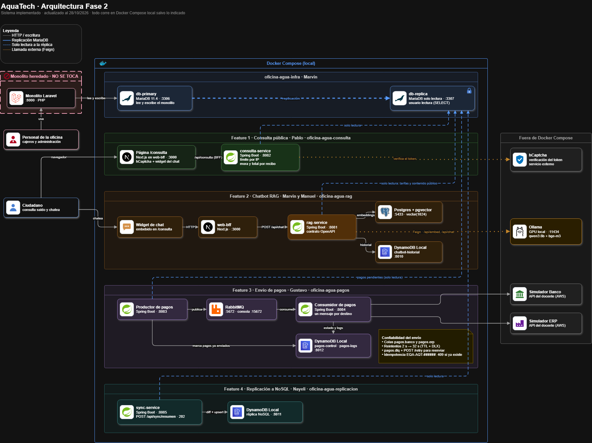

Nombre: Nayeli Melissa Urrutia Orellana

Carnet: 0905-23-5575

Repositorio: https://github.com/aquatech-umg/oficina-agua-replicacion

Modulo asignado: Replicación asíncrona a NoSQL | SQL

# oficina-agua-replicacion

Servicio de replicación de AquaTech: el `sync-service` (Spring Boot, puerto 8085) lee la réplica MariaDB (usuario `lectura`) y copia clientes y pagos a DynamoDB Local (puerto 8011).

## 1. Arquitectura de la solución integrada

La Fase 2 del proyecto AquaTech amplía el sistema original de la Oficina del Agua mediante cuatro funcionalidades independientes, sin modificar el monolito heredado desarrollado en Laravel.

El sistema utiliza una base de datos principal MariaDB, donde el monolito registra la información, y una réplica de solo lectura que permite a los nuevos microservicios consultar los datos sin afectar las operaciones del sistema original.

Las cuatro funcionalidades implementadas son:

1. **Consulta pública con captcha:** permite a los ciudadanos consultar su estado de cuenta mediante una página web protegida con hCaptcha.
2. **Chatbot con RAG:** responde preguntas utilizando información pública del sistema, modelos de inteligencia artificial y búsqueda semántica.
3. **Envío de pagos por colas:** utiliza RabbitMQ para enviar pagos al banco y al ERP municipal de forma asíncrona.
4. **Replicación asíncrona a NoSQL:** utiliza un microservicio Spring Boot para leer clientes y pagos de MariaDB y sincronizar los cambios hacia DynamoDB Local.

### Diagrama de arquitectura



El diagrama representa las conexiones entre el monolito, la infraestructura de bases de datos, los microservicios y los sistemas externos.

### Funcionamiento general

El monolito Laravel registra los datos en MariaDB principal. Estos datos se replican a MariaDB de solo lectura, desde donde los nuevos servicios obtienen la información necesaria.

Cada funcionalidad tiene responsabilidades independientes. En particular, el módulo de replicación consulta clientes y pagos, compara su información con DynamoDB y realiza inserciones o actualizaciones únicamente cuando detecta diferencias.

## 2. Componentes de la solución

La arquitectura de AquaTech Fase 2 está compuesta por los siguientes elementos:

| Componente | Tecnología | Puerto | Función |
|---|---|---|---|
| Monolito | Laravel y PHP | 8000 | Administración de clientes, contadores, recibos y pagos. |
| db-primary | MariaDB | 3306 | Base de datos principal del sistema. |
| db-replica | MariaDB | 3307 | Réplica de solo lectura utilizada por los microservicios. |
| web-bff | Next.js | 3000 | Página pública de consulta e integración del chatbot. |
| consulta-service | Spring Boot | 8082 | Consulta pública de estados de cuenta con captcha. |
| rag-service | Spring Boot | 8081 | Procesamiento de preguntas mediante RAG. |
| rag-db | PostgreSQL + pgvector | 5433 | Almacenamiento y búsqueda de vectores. |
| DynamoDB del chatbot | DynamoDB Local | 8010 | Historial de conversaciones. |
| Ollama | Modelos de inteligencia artificial | 11434 | Generación de respuestas y embeddings. |
| pagos-producer | Spring Boot | 8083 | Detecta pagos nuevos y publica mensajes. |
| RabbitMQ | Sistema de mensajería | 5672 / 15672 | Administración de las colas de pagos. |
| pagos-consumer | Spring Boot | 8084 | Envía los pagos al banco y al ERP. |
| DynamoDB de pagos | DynamoDB Local | 8012 | Control de envíos y registro de intentos. |
| sync-service | Spring Boot | 8085 | Sincroniza clientes y pagos desde MariaDB hacia DynamoDB. |
| DynamoDB de replicación | DynamoDB Local | 8011 | Almacena los clientes y pagos sincronizados. |
| hCaptcha | Servicio externo | HTTPS | Verificación de solicitudes de consulta pública. |
| Banco y ERP | API externas | HTTPS | Sistemas que reciben los pagos enviados. |

### Relación entre los componentes

El monolito trabaja con la base principal MariaDB. Esta mantiene una réplica de solo lectura que utilizan los nuevos servicios para consultar información.

Los módulos de consulta pública, chatbot, envío de pagos y replicación funcionan de manera independiente y se integran mediante sus conexiones a la infraestructura.

El microservicio `sync-service`, correspondiente al módulo de replicación, utiliza la réplica MariaDB como origen de datos y DynamoDB Local como destino, sin modificar la información del sistema original.

## 3. Cómo se ejecuta la solución completa

La solución integrada de AquaTech Fase 2 utiliza Docker Compose para ejecutar la infraestructura de bases de datos, mensajería y almacenamiento.

### 3.1 Requisitos previos

- Git.
- Docker Desktop.
- Java JDK 21.
- Node.js 22.
- PHP 8.3 y Composer.
- Maven Wrapper incluido en los servicios.
- Ollama para el funcionamiento del chatbot RAG.

### 3.2 Repositorios del proyecto

Los repositorios deben descargarse dentro de una misma carpeta de trabajo.

```bash
git clone https://github.com/aquatech-umg/oficina-agua-infra.git
git clone https://github.com/aquatech-umg/oficina-agua-consulta.git
git clone https://github.com/aquatech-umg/oficina-agua-rag.git
git clone https://github.com/aquatech-umg/oficina-agua-pagos.git
git clone https://github.com/aquatech-umg/oficina-agua-replicacion.git
git clone https://github.com/MCambara707/oficina-agua.git
```

### 3.3 Configuración

Cada repositorio debe configurarse utilizando sus archivos `.env.example`, copiándolos a archivos `.env` locales.

Las contraseñas y claves de acceso deben definirse localmente y no deben subirse a GitHub.

Los microservicios que consultan la réplica deben utilizar las credenciales de lectura configuradas en la infraestructura.

### 3.4 Levantar la infraestructura

Desde la carpeta `oficina-agua-infra`:

```powershell
docker compose -f docker-compose.equipo.yml up -d
docker compose -f docker-compose.equipo.yml ps
```

Este procedimiento inicia los componentes de infraestructura definidos en el archivo Compose del equipo, incluyendo MariaDB principal, réplica y los servicios auxiliares correspondientes.

### 3.5 Ejecutar los microservicios

Cada servicio Spring Boot se ejecuta desde su carpeta mediante Maven Wrapper:

```powershell
.\mvnw.cmd spring-boot:run
```

Los servicios principales son:

| Servicio | Puerto |
|---|---|
| consulta-service | 8082 |
| rag-service | 8081 |
| pagos-producer | 8083 |
| pagos-consumer | 8084 |
| sync-service | 8085 |

La aplicación pública desarrollada con Next.js se ejecuta desde `web-bff` mediante los comandos correspondientes de npm.

El monolito Laravel se ejecuta por separado y conserva su funcionalidad original.

### 3.6 Ejecución individual del módulo de replicación

Para ejecutar únicamente la replicación se necesita:

1. MariaDB principal y su réplica en funcionamiento.
2. DynamoDB Local disponible en el puerto 8011, con las tablas `clientes` y `pagos`.
3. Archivo `.env` configurado con `DB_REPLICA_PASSWORD`.

Desde la raíz de `oficina-agua-replicacion`:

```powershell
docker compose up -d
cd sync-service
.\mvnw.cmd spring-boot:run
```

El servicio queda disponible en `http://localhost:8085`.

La configuración local se carga desde el archivo `.env`, mediante `spring.config.import`, sin necesidad de establecer manualmente todas las variables en la terminal.

La documentación técnica detallada se encuentra en [sync-service/README.md](sync-service/README.md).

## 4. Módulo asignado: replicación asíncrona a NoSQL

### 4.1 Funcionalidad y objetivo

El objetivo de este módulo es mantener una copia de los clientes y pagos del sistema Oficina del Agua en una base de datos NoSQL, sin modificar el monolito Laravel ni realizar escrituras en la réplica MariaDB.

Para lograrlo, se desarrolló `sync-service`, un microservicio Spring Boot que ejecuta trabajos de sincronización en segundo plano.

Su funcionamiento consiste en:

1. Recibir una solicitud HTTP para iniciar la sincronización.
2. Crear un trabajo identificado mediante un `jobId`.
3. Leer clientes y pagos de la réplica MariaDB por páginas.
4. Consultar los registros correspondientes en DynamoDB Local.
5. Comparar la información para identificar registros nuevos o modificados.
6. Insertar o actualizar únicamente los registros que presentan diferencias.
7. Registrar el progreso y el resultado del trabajo.

El servicio permite consultar el avance sin esperar a que termine toda la sincronización.

### 4.2 Integración y responsabilidades

| Componente | Responsabilidad |
|---|---|
| Monolito Laravel | Registra la información original de la Oficina del Agua. |
| MariaDB principal | Almacena los datos utilizados por el monolito. |
| MariaDB réplica | Proporciona clientes y pagos mediante consultas de solo lectura. |
| sync-service | Coordina la lectura, comparación y sincronización de registros. |
| DynamoDB Local | Almacena la copia NoSQL de clientes y pagos. |
| API REST | Permite iniciar trabajos y consultar su estado. |

El módulo no modifica directamente la base de datos principal ni elimina registros del destino cuando desaparecen del origen.

### 4.3 Decisiones técnicas justificadas

**1. Sincronización asíncrona**

Se utiliza una ejecución en segundo plano para evitar que la solicitud HTTP permanezca abierta mientras se procesan miles de registros.

El endpoint POST responde con HTTP 202 y devuelve un `jobId`. Posteriormente, el cliente puede consultar el progreso mediante GET.

**2. Lectura paginada sin OFFSET**

El módulo utiliza consultas basadas en el último identificador procesado:

```sql
SELECT ...
FROM ...
WHERE id > ultimoId
ORDER BY id
LIMIT cantidad;
```

Esta estrategia permite recorrer los registros por páginas sin cargar toda la información en memoria y evita el costo de desplazarse mediante OFFSET.

**3. Estrategia diff y upsert**

Antes de escribir en DynamoDB, el servicio compara los campos administrados por la réplica.

- Si el registro no existe, lo inserta.
- Si existe y presenta diferencias, lo actualiza.
- Si la información es idéntica, no realiza ninguna escritura.
- Si DynamoDB contiene atributos exclusivos del destino, los conserva.

Esto reduce escrituras innecesarias y permite repetir la sincronización sin duplicar registros.

**4. Manejo del progreso y errores**

El trabajo registra los registros procesados, las escrituras confirmadas y el porcentaje de avance.

El estado `COMPLETADO` con 100 % se alcanza únicamente cuando la sincronización termina correctamente. Si ocurre un error, el trabajo pasa a `FALLIDO`.

### 4.4 Instrucciones para probar el módulo

**Requisitos previos**

- MariaDB principal y réplica disponibles.
- Datos de prueba cargados.
- DynamoDB Local en el puerto 8011.
- Tablas `clientes` y `pagos` creadas.
- Archivo `.env` con la contraseña de lectura de MariaDB.
- Java y Maven Wrapper disponibles.

**1. Iniciar el microservicio**

Desde `oficina-agua-replicacion/sync-service`:

```powershell
.\mvnw.cmd spring-boot:run
```

**2. Crear un trabajo de sincronización**

En otra terminal PowerShell:

```powershell
$job = Invoke-RestMethod -Method Post -Uri "http://localhost:8085/api/sync/resumen"
$job
```

**Resultado esperado:** respuesta HTTP 202 con un `jobId` y estado inicial `PENDIENTE`.

**3. Consultar el progreso**

```powershell
Invoke-RestMethod -Uri "http://localhost:8085/api/sync/jobs/$($job.jobId)"
```

**Resultado esperado:** información del trabajo, estado, porcentaje de avance y contadores de procesamiento.

Al finalizar correctamente, el estado debe ser `COMPLETADO` y el progreso 100 %.

**4. Verificar el comportamiento diff-upsert**

Ejecutar una sincronización sin modificar los datos.

**Resultado esperado:** si DynamoDB ya está actualizado, no se realizan escrituras innecesarias.

Después, modificar de forma controlada un cliente en el origen de pruebas, esperar a que el cambio llegue a la réplica y ejecutar una nueva sincronización.

**Resultado esperado:** el registro correspondiente se actualiza en DynamoDB.

### 4.5 Resultados de las pruebas AQ-130

Durante la validación masiva del 20 de octubre de 2026 se registraron los siguientes resultados:

| Prueba | Resultado |
|---|---|
| Registros procesados | 37,579 |
| Clientes procesados | 500 |
| Pagos procesados | 37,079 |
| Sincronización sin cambios | 0 escrituras |
| Cambio de un cliente | 1 escritura |
| Restauración del cliente | 1 escritura |
| Estado final de las pruebas exitosas | COMPLETADO, 100 % |

También se comprobó la conservación de atributos exclusivos de DynamoDB, como `notaInterna`.

Estos resultados corresponden a las pruebas realizadas con datos previamente cargados en DynamoDB. No representan una medición de carga inicial desde tablas vacías.

### 4.6 Limitaciones conocidas

Los trabajos y el control de concurrencia se almacenan en memoria, por lo que se pierden al reiniciar el microservicio.

La comparación con DynamoDB se realiza registro por registro. Además, la lectura de la réplica no utiliza una instantánea transaccional del conjunto completo de datos.

Para más detalles técnicos, consultar [sync-service/README.md](sync-service/README.md).